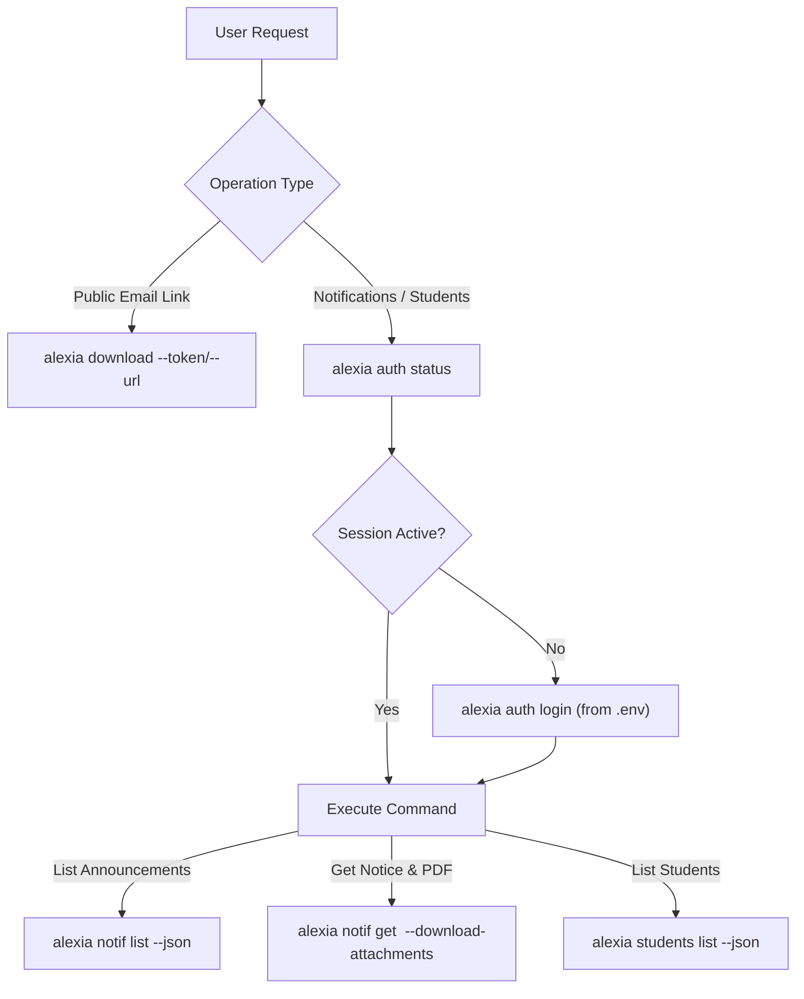

# AlexiaEdu CLI (`alexia`) Skill

This skill guides AI agents on how to interact with the **`alexia`** CLI client to manage school communications, circulars, and student information from **Alexia Familias** (`web2.alexiaedu.com`) for **Everest School**.

---

## ⚡ When to Use

Activate and use this skill when:
- The user asks about school notices, communications, or circulars from Alexia.
- The user asks to list, inspect, or download attachments from school announcements.
- The user asks for information about their enrolled children, classes, courses, or extracurricular activities.
- Downloading public circular documents linked in school emails via token or URL.
- Verifying the current Alexia Familias session status.

---

## 🛠️ CLI Environment & Invocation

Always run `alexia` within the project virtual environment:

```bash
# Within the project repository
source .venv/bin/activate
alexia --help
```

> [!TIP]
> **Agent Best Practice:** For automated data extraction, **always pass `--json`** to commands that support it (`notif list`, `students list`) to obtain structured, parseable JSON output rather than Rich terminal tables.

---

## 📋 Command Reference for Agents

### 1. Session & Authentication Management

Before calling authenticated endpoints (`notif`, `students`), always check if an active session exists.

#### Check Session Status
```bash
alexia auth status
```
* **Exit code 0:** Displays session details (user, role GUID, token, server status).
* **If expired or unauthenticated:** Server row will display `Sesión inactiva` or `No hay ninguna sesión guardada`.

#### Log In
```bash
# Non-interactive (uses .env or environment variables ALEXIA_USER and ALEXIA_PASS):
alexia auth login

# Explicit credentials:
alexia auth login --user "<USER>" --password "<PASS>"
```

#### Log Out
```bash
alexia auth logout
```

---

### 2. Students & Academic Information (`alexia students`)

Retrieves enrolled children/students linked to the family account, including grade level, course/classroom, and extracurricular activities.

#### List Students (Machine-readable JSON)
```bash
alexia students list --json
```
* **Output structure:**
  ```json
  [
    {
      "id": "00000000-0000-0000-0000-000000000001",
      "persona_key": "11111111-1111-1111-1111-111111111111",
      "nombre": "Lucas García",
      "parentesco": "Hijo",
      "curso": "Tercero de Primaria B",
      "matriculas": [
        "Tercero de Primaria B",
        "Comedor Mensual",
        "Fútbol"
      ],
      "foto_url": "https://web2.alexiaedu.com/ACWeb/controladores/ControladorFotografias.ashx?..."
    }
  ]
  ```

#### Fast List (Skip Academic Query)
```bash
alexia students list --no-details
```

---

### 3. Circulars & Announcements (`alexia notif`)

Queries communications sent by Everest School (announcements, circulars, authorizations).

#### List Recent Announcements
```bash
# List last 10 announcements as JSON:
alexia notif list --json --limit 10

# Filter only unread announcements:
alexia notif list --unread --json
```
* **Output structure:**
  ```json
  [
    {
      "id": "00000000-0000-0000-0000-000000000001",
      "title": "Circular Informativa Trimestral",
      "date": "26/11/2026",
      "sender": "Colegio de Prueba",
      "read": false,
      "has_attachments": true
    }
  ]
  ```

#### Inspect Announcement Content
```bash
alexia notif get <COMUNICADO_ID>
```
* Displays the subject, publication timestamp, sender, clean text body, and list of attached filenames.

#### Inspect and Download All Attachments
```bash
alexia notif get <COMUNICADO_ID> --download-attachments -o ./downloads/
```
* Downloads all attached PDFs directly into `./downloads/` using their original filenames.

#### Mark Announcement as Read
```bash
# Mark a single announcement by ID:
alexia notif mark-read <COMUNICADO_ID>

# Mark all unread announcements older than N hours (default 24h):
alexia notif mark-all-read --older-than-hours 24
```

---

### 4. Public Circular Downloads (`alexia download`)

School notification emails often link to `Repositorio.aspx?token=<TOKEN>`. These can be downloaded **without logging in**:

```bash
# Download by token:
alexia download --token "<TOKEN_FROM_EMAIL>" -o ./circular.pdf

# Download by full URL:
alexia download --url "https://web2.alexiaedu.com/ACWeb/paginas/publicas/Repositorio.aspx?token=..." -o ./circular.pdf
```

---

## 🔄 Recommended Agent Workflow



---

## 🔒 Safety & Privacy Constraints for Agents

1. **Never print or log credentials:** Do not output the user's password or authentication tokens in chat.
2. **Never commit `.env` or session files:** Keep `.env` and `~/.config/alexia/session.json` local.
3. **Handle missing sessions gracefully:** If an operation returns 401/unauthenticated, prompt the user or run `alexia auth login` using `.env`.
